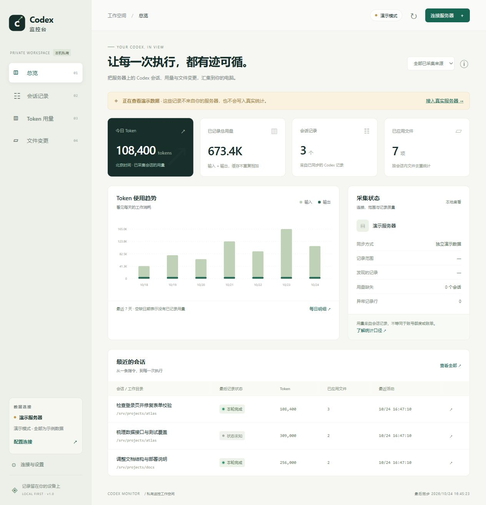

# Codex 监控台 · Codex Monitor

在自己的 Windows 电脑上，查看服务器 Codex 的会话、token 用量和文件变更，并在每轮对话结束时收到桌面提醒。

**v1.2.0 · Windows 10 / 11 x64 · Python 3.12 · MIT**

独立社区工具，非 OpenAI 或 Tailscale 官方产品。使用已有的服务器 SSH 权限即可，不需要 OpenAI API Key，也不读取 Codex 登录凭据。



## 能做什么

- 通过普通 SSH 密码 / 密钥，或 Tailscale SSH 连接自己的 Linux / macOS 服务器。
- 查看已保存的输入、回复、命令、工具结果和补丁，支持搜索。
- 统计每日输入、缓存和输出 token，支持 CSV 导出；日期按北京时间归档。
- 区分文件修改提议、成功补丁与失败记录；查看项目当前 Git 差异。
- Tailscale 按钮直接打开官方登录网页；服务器需要额外认证时，打开该次连接的验证链接。
- 密码可点击显示 / 隐藏。服务器 VS Code 集成终端里的 Codex 每轮完成后，可在本机通知。
- 首批记录先展示，历史在后台分批补齐；也支持本机目录与 JSONL 导入。

## 下载运行

从本仓库 **Releases** 下载 `CodexMonitor-v1.2.0-windows-x64.zip`，完整解压后双击文件夹里的 `CodexMonitor.exe`。无需安装 Python，请保留同目录的 `_internal` 文件夹。

1. 点击“连接服务器”，填写你自己的服务器地址、SSH 用户名与登录方式。
2. 首次连接时核对服务器指纹，再选择信任。
3. 默认读取 `~/.codex`；设置了自定义 `CODEX_HOME` 时，填写服务器上的实际绝对路径。
4. 仍在服务器原终端使用 Codex，监控台自动同步。

服务器需安装 Python 3；查看 Git 差异需安装 Git。Tailscale 连接还需本机系统 OpenSSH 与可用的 Tailscale 网络。**网页登录本身不会安装或配置本机 Tailscale 网络**，也不会修改访问规则。

通知需要后台服务保持运行。浏览器可以关闭，服务窗口的 × 会最小化；点击“退出软件并停止同步”才会退出。Windows 勿扰设置可能影响弹窗显示。

完整设置与统计说明见 [使用手册](docs/USER_GUIDE.zh-CN.md)。遇到连接问题见 [故障排查](docs/TROUBLESHOOTING.zh-CN.md)。

## 从源码运行

以下命令在仓库目录的 Windows PowerShell 中运行，需 Python 3.12 x64 与 Git：

```powershell
py -3.12 -m venv .venv
.\.venv\Scripts\python.exe -m pip install -r requirements.txt
.\.venv\Scripts\python.exe main.py
```

无需激活虚拟环境。依赖只需首次安装，之后直接运行最后一行。桌面版和通知目前只承诺支持 Windows；远程采集端支持 Linux / macOS。

## 测试与构建

```powershell
.\.venv\Scripts\python.exe -m pip install -r requirements-build.txt
.\.venv\Scripts\python.exe -m unittest discover -p "test_*.py" -v
powershell -NoProfile -ExecutionPolicy Bypass -File .\build.ps1 -Python .\.venv\Scripts\python.exe
```

构建脚本会执行测试、生成便携程序、验证资源，并在 `release/` 生成 Windows 压缩包、源码包和 SHA-256 校验文件。`-ExecutionPolicy Bypass` 只作用于本次构建进程。GitHub Actions 配置见 [.github/workflows](.github/workflows)。

发布流程见 [维护者发布指南](docs/RELEASING.zh-CN.md)，版本记录见 [CHANGELOG](CHANGELOG.md)。

## 数据与范围

数据仅保存在运行目录的 `data/`；HTTP 服务只监听 `127.0.0.1`，使用每次运行生成的访问令牌。密码与密钥口令仅保留在内存。不会在服务器安装常驻采集服务或读取 Codex 的 `auth.json`。

这是保存记录的查看器，不是终端屏幕直播。统计只覆盖采集到的记录，**不等于官方账号总用量、剩余额度或费用**。缓存输入包含在输入中，不重复相加。部分工具修改可能缺少补丁记录；当前 Git 差异包含整个工作目录的变更，不能据此断定某次对话的贡献。

内部日志格式会随 Codex 版本变化。缺失数据会明确标记，不推测用量或完成状态。只根据明确的每轮完成事件通知，开始监控之前的历史记录不会弹出。

备份或升级时保留 `data/`。**请勿将自己运行后的 `data/`、SSH 密钥、连接配置或真实会话上传到 GitHub。** 仓库的 `.gitignore` 已忽略常见私有文件，发布脚本另外使用文件白名单。

## 贡献与许可

欢迎提交问题与改进，见 [贡献说明](CONTRIBUTING.md) 和 [安全说明](SECURITY.md)。

本项目原创源码使用 [MIT License](LICENSE)。第三方组件保留各自许可，见 [第三方声明](THIRD_PARTY_NOTICES.md)；Paramiko 的对应源码随发布包提供。

## English

A private Windows dashboard for Codex transcripts stored on your own server. It reads saved logs over SSH, displays conversations, daily token usage and file changes, and sends local notifications when an explicit turn-completion event is recorded. No OpenAI API key is required. This is an independent project, not an official OpenAI or Tailscale product. Download the Windows x64 ZIP from Releases, extract the entire folder, and run `CodexMonitor.exe`. Keep your `data/` directory private. Usage shown here is collected log usage, not an account quota or billing report.
